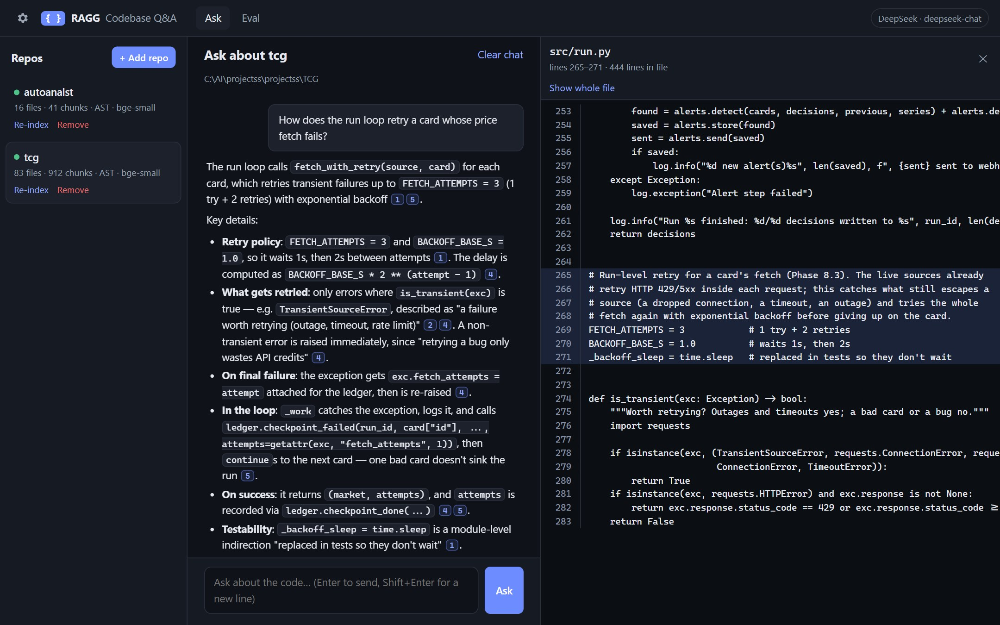
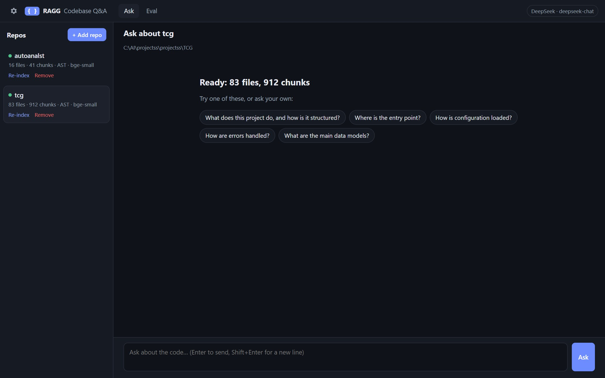
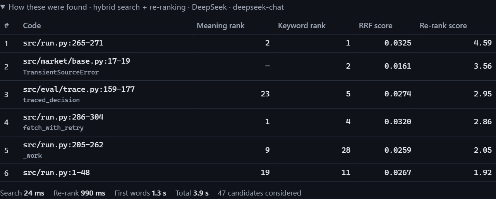
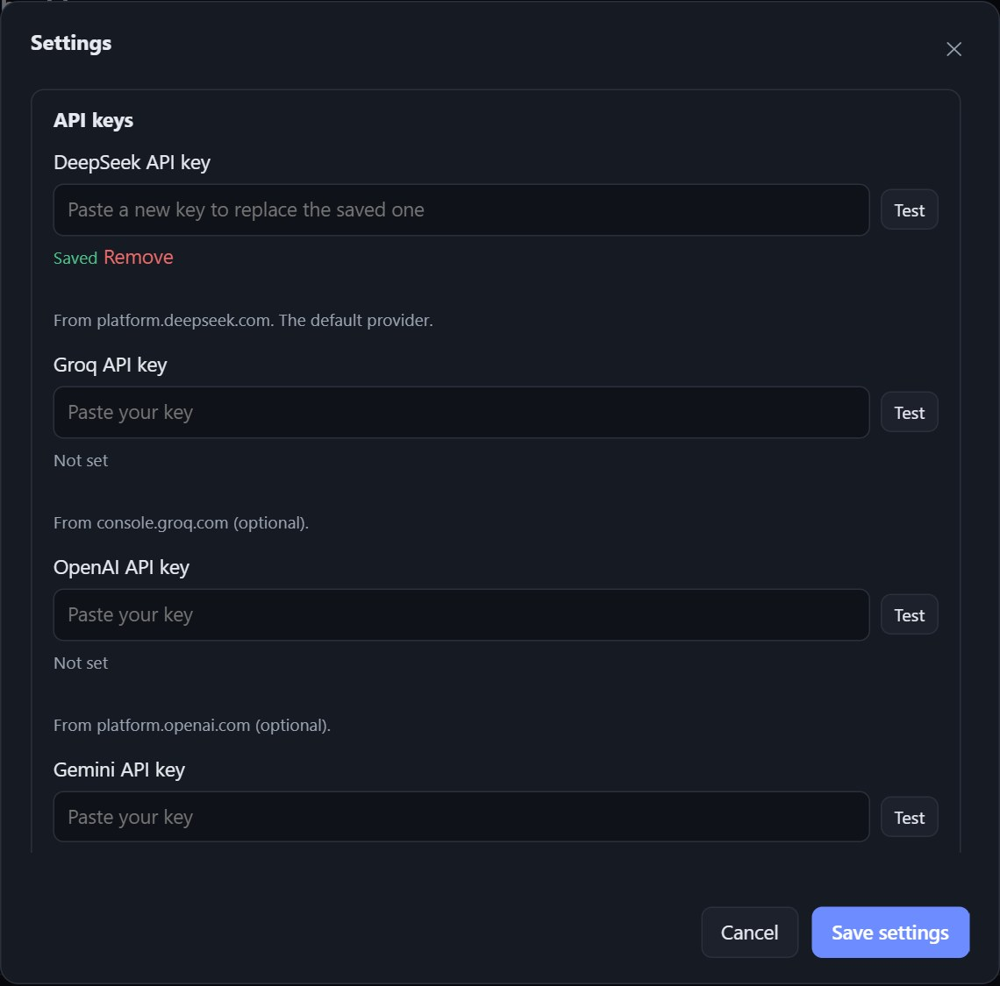
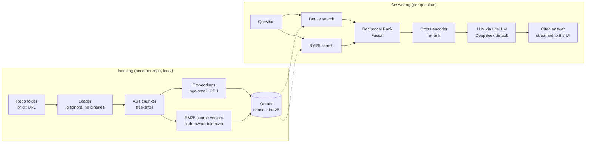
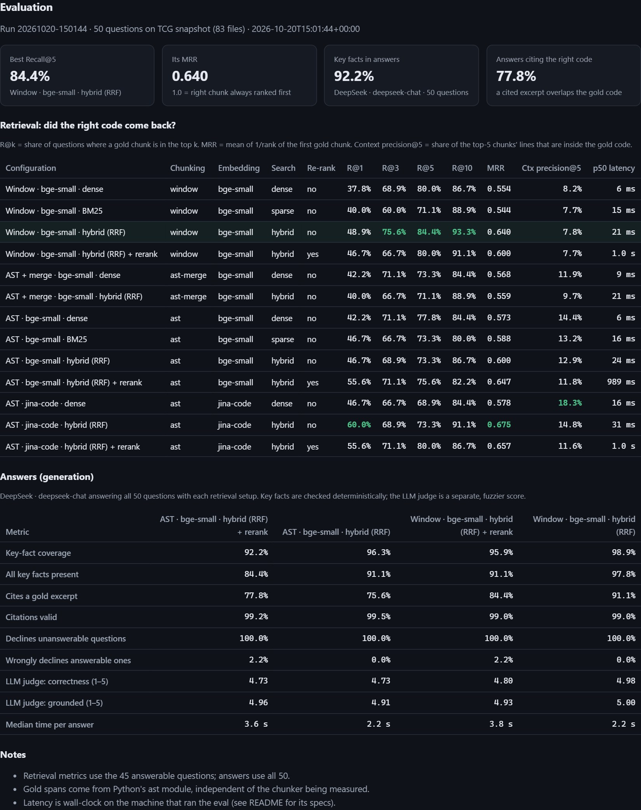

# RAGG: Codebase Q&A

**Ask questions about any codebase in plain English, and get answers grounded
in the real code, with clickable citations to the exact files and lines.**



Ask *"How does the run loop retry a card whose price fetch fails?"* and RAGG:
1. finds the right code (`fetch_with_retry`, `is_transient`, the retry constants);
2. explains it with citations like **[1]**;
3. opens the code at the cited lines when you click one.

When the code doesn't contain the answer, it says so instead of making
something up.

| | |
|---|---|
| 🧩 **AST-aware chunking** | tree-sitter splits code at function and class boundaries, in 15 languages |
| 🔎 **Hybrid retrieval** | dense embeddings + BM25 keyword search, fused with Reciprocal Rank Fusion |
| 🎯 **Cross-encoder re-ranking** | ms-marco-MiniLM re-orders the best candidates |
| 🔌 **Any LLM** | DeepSeek by default; Groq, OpenAI or Gemini through LiteLLM, switched in Settings |
| 📏 **Measured, not guessed** | a 50-question benchmark with gold answers backs every design choice ([results](eval/RESULTS.md)) |
| 💻 **Runs on a laptop** | models run locally on the CPU; no GPU, no Docker, no database server. Only the final answer uses an API |

**Benchmark headline** (50 questions about a real 83-file codebase, DeepSeek answering):
- **97.8%** of answerable questions answered with every required fact;
- **91.1%** cite the code that actually answers the question;
- **5/5** questions about features the code doesn't have were correctly declined.

---

## Contents

1. [Install](#1-install)
2. [Start it and ask your first question](#2-start-it-and-ask-your-first-question)
3. [Using the app](#3-using-the-app)
4. [Settings](#4-settings)
5. [How it works](#5-how-it-works)
6. [Evaluation: measured results](#6-evaluation-measured-results)
7. [Performance on your machine](#7-performance-on-your-machine)
8. [Command-line reference](#8-command-line-reference)
9. [Troubleshooting](#9-troubleshooting)
10. [Project layout and tests](#10-project-layout-and-tests)

---

## 1. Install

**You need:**
- **Python 3** (developed and tested on 3.14);
- **git**, only for indexing repos from a URL.

Qdrant runs inside the app, and the models run on your CPU.

```bash
git clone <this repo> RAGG
cd RAGG
python -m venv .venv
```

Activate the virtual environment:
- **Windows (PowerShell):** `.venv\Scripts\activate`
- **macOS / Linux:** `source .venv/bin/activate`

```bash
pip install -r requirements.txt
```

**Optional, recommended:** download the local models once, so the first
question isn't slow and everything after works offline:

```bash
python -m app.setup_models
```

That's about 130 MB (embedding model) + 90 MB (re-ranker) + 60 MB (tree-sitter
grammars). Without this step, each one downloads automatically the first time
it's needed.

## 2. Start it and ask your first question

```bash
python -m app
```

Your browser opens at **<http://127.0.0.1:8000>**. Use `--port 8080` if 8000 is
taken, and `--no-browser` to skip opening it.

1. **Add your API key:**
   - click the **⚙ gear (top left)** → **API keys**;
   - paste your DeepSeek key (from [platform.deepseek.com](https://platform.deepseek.com));
   - **Test** → **Save settings**.

   A yellow banner reminds you until a key is set.
2. **Add a repo:** press **+ Add repo** and give either
   - a **folder path**, e.g. `C:\code\my-project`, or
   - a public **https git URL**, e.g. `https://github.com/owner/repo`.
3. **Wait for indexing.** A progress bar shows in the sidebar. A typical project
   takes a minute or two on a laptop, once.
4. **Ask.** Type a question, or click one of the suggestions, and press **Enter**.



## 3. Using the app

### The layout

| Area | What it does |
|---|---|
| **⚙ Gear (top left)** | Settings: API keys, which LLM answers, retrieval and indexing options |
| **Ask / Eval** | Switch between asking questions and the benchmark results |
| **Model badge (top right)** | Which LLM is answering (yellow = no key yet) |
| **Repos (left)** | Your indexed repos: files, chunks, chunking method, embedding model. Click one to ask about it |
| **Chat (middle)** | Your questions and the streamed answers |
| **Code viewer (right)** | Opens when you click a citation or a source |

### Asking

- **Enter** sends; **Shift+Enter** starts a new line.
- The answer **streams in** as it's written. It's built only from the code that
  was found, and every claim cites its source like **[2]**.
- If the code doesn't contain the answer, it **says so** instead of guessing.
- **Follow-ups work:** "and how is that tested?" includes the previous question
  when searching, and the last few turns are passed to the LLM.
- Each repo keeps its own chat in your browser; **Clear chat** resets it.

### How each answer was found

Under every answer:
- **Source chips:** every code chunk the LLM was shown, e.g. `[1] run.py:286-304 fetch_with_retry`. The ones it actually cited are outlined.
- **"How these were found"** (click to expand): exactly why each chunk was picked, and how long each step took.



| Column | Meaning |
|---|---|
| **Meaning rank** | Its position in the dense (embedding) search: similar *meaning* |
| **Keyword rank** | Its position in the BM25 search: matching *words and identifiers* |
| **RRF score** | The two rankings fused: `Σ 1 / (60 + rank)` |
| **Re-rank score** | The cross-encoder's relevance score; it decides the final order |

### The code viewer

Click any **[n]** in an answer, or any source chip:
- the file opens at the cited lines, highlighted, with line numbers;
- **Show whole file** shows the rest of it;
- **Esc** or **✕** closes it.

### Managing repos

- **Re-index** updates the index. Only files that changed are re-read and
  re-embedded, so it's quick.
  - After you change the chunking or embedding settings (or upgrade RAGG), a repo
    shows *"Settings changed: re-index to apply"*; re-indexing rebuilds it.
- **Remove** deletes the repo's index (and its clone, for git URLs). Your own
  folder is never touched.

### What gets indexed

- ✅ **Code with AST chunking:** Python, JavaScript, TypeScript/TSX, Java, Go, Rust, Ruby, PHP, C, C++, C#, Kotlin, Swift, Scala.
- ✅ **Text, chunked by line windows:** Markdown, YAML, JSON, HTML, CSS, SQL, shell scripts and similar.
- ⛔ **Skipped:**
  - anything in `.gitignore` (including nested ones);
  - `node_modules`, `.venv`, `dist`, `build` and other vendored or generated folders;
  - binaries, minified bundles, and files over the size limit (300 KB by default);
  - your own extra patterns.
- 🔒 **Nothing in a repo is ever run.** Files are only read as text.

## 4. Settings



How settings work:
- Everything is saved to `.env` and applies to the next question or indexing job, with no restart.
- Keys are **write-only**: the app only ever shows "Saved".
- [.env.example](.env.example) lists every setting with its default.

| Group | Setting | Default | What it does |
|---|---|---|---|
| API keys | DeepSeek / Groq / OpenAI / Gemini key | – | Only the chosen provider's key is needed. **Test** makes one tiny call |
| Answering | Provider | DeepSeek | Which LLM writes answers; switching is just this setting |
| | Model | provider default | Empty = `deepseek-chat`, `llama-3.3-70b-versatile`, `gpt-4o-mini` or `gemini-2.0-flash` |
| | Temperature | 0.1 | Lower = more literal |
| | Longest answer | 1200 tokens | |
| Retrieval | Search | Hybrid | Hybrid (meaning + keywords), meaning only, or keywords only |
| | Re-rank with the cross-encoder | on | Better #1 result, ~0.4 s per question; didn't improve answers in the eval ([§6](#6-evaluation-measured-results)) |
| | Code chunks given to the LLM | 6 | |
| | Candidates per search / re-ranked | 30 / 20 | Fewer = faster on slow machines |
| | RRF constant k | 60 | The standard value |
| Indexing | Chunking | By function/class | Or fixed windows of lines |
| | Window size / overlap | 60 / 15 lines | For window chunking and non-code files |
| | Embedding model | bge-small | Or jina-code (code-specific, ~640 MB, ~6.5× slower to index), or bge-base |
| | Embedding batch size | 8 | The measured sweet spot; lower it on a small laptop |
| | Skip files larger than | 300 KB | |
| | Also ignore | – | Extra globs, e.g. `docs/**, *.min.js` |
| Storage | Qdrant server URL / API key | – | Empty = embedded Qdrant in `data/qdrant` (no server) |

**Switching LLM providers:** paste that provider's key, pick it under
**Answering → Provider**, save. Nothing else changes.

## 5. How it works



| Step | Module | How |
|---|---|---|
| **Load** | `app/loader.py` | Walks the repo, applies `.gitignore`, skips junk; https git URLs are shallow-cloned (no shell, no prompts) |
| **Chunk** | `app/chunking.py` | tree-sitter parse:<br>• one chunk per function, method or class, never cut mid-definition;<br>• comments above a definition belong to it;<br>• big classes become a header + one chunk per method, each knowing its class;<br>• huge functions are split into parts that keep the signature.<br>Exact line numbers are kept for citations |
| **Keywords** | `app/bm25.py` | BM25 as sparse vectors. The tokenizer splits `snake_case` and `camelCase` but keeps whole identifiers, and folds plurals. Document weights are computed at index time; Qdrant supplies the idf term |
| **Index** | `app/indexer.py`, `app/store.py` | Dense + sparse vectors per chunk. Incremental by file hash; runs as a background job with progress |
| **Retrieve** | `app/retrieval.py` | Dense + BM25 → RRF (`Σ 1/(k + rank)`) → cross-encoder re-rank. Every stage's rank, score and timing is kept |
| **Answer** | `app/generation.py`, `app/llm.py` | Numbered excerpts with path:lines; the model must cite `[n]` and admit when the code doesn't say. One `complete`/`stream` interface over LiteLLM |
| **Serve** | `app/api.py`, `web/` | FastAPI with server-sent events for streaming; plain HTML/CSS/JS front end with no build step |

**Design choices:**
- **No RAG framework.** No LangChain or LlamaIndex: the whole app is ~1,700
  lines of plain, commented Python. LiteLLM is used for exactly one job:
  talking to different LLM providers through one interface.
- **Grounding over fluency.** The prompt forbids outside knowledge about the
  codebase. Citation numbers are checked, and invalid ones are dropped.
- **Safe by construction:**
  - the server listens only on 127.0.0.1;
  - every state-changing request needs an `X-RAGG` header, which a website on another origin can't add without a CORS preflight the server never approves (CSRF);
  - the code viewer only serves files that are in a repo's index;
  - answers are rendered with `textContent`, never `innerHTML`, so code in a repo can't inject markup.
- **Indexes know how they were built.** Each records its chunker, embedding
  model and chunking-rules version. A mismatch triggers a rebuild, never a mix
  of incompatible chunks or vectors.

## 6. Evaluation: measured results

The benchmark runs against a frozen codebase: a snapshot of the TCG project,
83 files, mostly Python. It uses 50 hand-written questions:
- **45 answerable**, each with its gold code location and 2–3 required key facts;
- **5 about things the code doesn't have**, to check the system says so instead of inventing an answer.

The gold locations are resolved with Python's own `ast`, so they're independent
of the chunker being tested.



**Retrieval (45 answerable questions):**

| Setup | Recall@5 | MRR | Relevant share of retrieved code |
|---|---|---|---|
| Fixed 60-line windows · hybrid | **84.4%** | 0.640 | 7.8% |
| AST chunks · hybrid | 73.3% | 0.600 | **12.9%** |
| AST chunks · hybrid + re-rank | 75.6% | 0.647 | 11.8% |
| AST chunks · jina code model · hybrid | 73.3% | **0.675** | 14.8% |

**Answers, DeepSeek (all 50 questions):**

| Setup | Every key fact right | Cites the right code | Declines unanswerable |
|---|---|---|---|
| Windows · hybrid | **97.8%** | **91.1%** | 5 / 5 |
| AST · hybrid | 91.1% | 75.6% | 5 / 5 |
| AST · hybrid + re-rank | 84.4% | 77.8% | 5 / 5 |

**What the numbers say:**
- **Hybrid search beats meaning-only and keyword-only search.**
- **AST chunks are ~1.7× more precise:** more of what the LLM reads is relevant.
  On this codebase, though, 60-line windows find the answer more often. Its long
  module docstrings outrank the implementing code when they're separate chunks,
  while a window keeps docstring and code together.
- **The cross-encoder improves the #1 result** (Recall@1 46.7% → 55.6% on AST
  chunks) but didn't improve final answers here. ms-marco is a web-search model,
  not a code model.
- **It's reproducible.** Retrieval is deterministic, and a second full run
  matched the first.

Chunking mode and re-ranking are each a single setting, so you can pick what
suits your codebase. Full tables, methodology, what was tried and rejected, and
limitations: **[eval/RESULTS.md](eval/RESULTS.md)**.

**Run the benchmark yourself:**

```bash
python -m eval.run
```

That's the retrieval benchmark for every configuration: deterministic, no API
key. Add `--generation --judge` to have the configured LLM answer all 50
questions and score them (~200 small API calls). `--quick` skips the 640 MB code
model.

## 7. Performance on your machine

Everything local runs on the CPU (ONNX Runtime); a GPU is never used or needed.
Measured on an Intel i7-14700F with nothing heavy running alongside:

| What | Measured |
|---|---|
| Memory with both models loaded, ready to answer | ~500 MB |
| Peak memory while indexing | ~890 MB |
| Peak memory while answering, re-ranker on | ~1.1 GB |
| Indexing the 83-file test repo (912 chunks), bge-small | 17 s |
| …with the jina code model instead | 155 s (≈ 6.5× slower) |
| Search per question (dense + BM25 + fusion) | ~20–30 ms (median) |
| Re-ranking 20 candidates | ~0.4 s |
| DeepSeek's answer | ~2–4 s, set by the API, not your machine |

**On an ordinary laptop** (4–8 cores, 8 GB RAM), expect indexing to take a few
times longer: roughly 1–2 minutes per 1,000 chunks, once per repo. That's an
estimate, not a measurement. Searching stays well under a second, and memory
stays around 1 GB.

**Defaults chosen from these measurements:**
- **Embedding batch size 8:** half the memory of 32, no slower.
- **Re-ranking in batches of 4:** a third of the peak memory, no slower.

**For a slow or low-memory machine:**
- keep bge-small;
- turn **Re-rank** off;
- lower the batch size further.

## 8. Command-line reference

| Command | What it does |
|---|---|
| `python -m app [--port 8000] [--no-browser]` | Start the app |
| `python -m app.setup_models [--all]` | Download the models and grammars once (`--all`: every embedding model) |
| `python -m eval.run [--quick]` | Retrieval benchmark: deterministic, no API key (`--quick` skips the jina model) |
| `python -m eval.run --generation [--judge]` | Also generate and score answers with the configured LLM (needs a key) |
| `python -m eval.run --limit N` | A quick smoke run on the first N questions |
| `python -m eval.run --rescore RUN_ID` | Recompute a saved run's answer metrics (no API calls) |
| `python -m eval.gold` | Check every gold answer and key fact in the suite |
| `pytest` | The test suite: offline, no models or API calls |

## 9. Troubleshooting

| Problem | What to do |
|---|---|
| Yellow "No DeepSeek API key yet" banner | ⚙ Settings → API keys → paste the key → **Test** → **Save** |
| "Folder not found" when adding a repo | Paste the full path, e.g. `C:\code\project` (quotes around it are fine) |
| A git URL won't clone | Only public `https://` URLs work (no SSH, no private repos). Check that `git --version` works in a terminal |
| The first question is slow | The models load (or download) on first use; run `python -m app.setup_models` once |
| Indexing is slow on an old laptop | Keep bge-small, lower **Embedding batch size**, and add big folders to **Also ignore**. It's a one-time cost per repo |
| Answers feel slow | Turn **Re-rank** off, or lower **Candidates re-ranked** to 10 |
| "Storage folder is already accessed by another instance" | Embedded Qdrant allows one process at a time: close the other RAGG window or terminal, or use a Qdrant server (Settings → Storage) |
| "The code doesn't contain that", but it does | Name the function or file in the question, re-index if the code changed, or raise **Code chunks given to the LLM** |
| "Settings changed: re-index to apply" | You changed chunking or the embedding model (or upgraded RAGG): press **Re-index** |
| A big `--generation` eval run doesn't exit after printing its results | A known issue: LiteLLM's logging threads keep the process alive. The results are already saved, so close it with Ctrl+C |

Logs are in `data/ragg.log`.

## 10. Project layout and tests

```
RAGG/
├── app/
│   ├── __main__.py      python -m app: starts the server
│   ├── api.py           FastAPI routes (CSRF guard, streaming)
│   ├── config.py        settings registry (.env, validation, masking)
│   ├── loader.py        reading repos (.gitignore, git clone)
│   ├── chunking.py      AST-aware chunker (tree-sitter) + window baseline
│   ├── bm25.py          code-aware tokenizer + BM25 sparse vectors
│   ├── models.py        local embedder + cross-encoder (fastembed)
│   ├── store.py         Qdrant + repo registry
│   ├── indexer.py       indexing jobs (incremental, background)
│   ├── retrieval.py     dense + BM25 + RRF + re-rank
│   ├── llm.py           LiteLLM wrapper (DeepSeek, Groq, OpenAI, Gemini)
│   ├── generation.py    prompt, citations, streaming answers
│   └── setup_models.py  one-time downloads
├── web/                 index.html, app.css, app.js (no build step)
├── eval/
│   ├── corpus/tcg/      frozen snapshot of the TCG project (the test codebase)
│   ├── qa.jsonl         50 questions with gold code locations and key facts
│   ├── gold.py          ground truth (resolved with Python's ast, not the chunker)
│   ├── metrics.py       Recall@k, MRR, context precision, key facts, declines
│   ├── run.py           the benchmark runner
│   ├── results/         every run: summary.json, per-question results, report.md
│   └── RESULTS.md       the measured write-up
├── docs/                screenshots
├── tests/               pytest: offline (fake embedder, in-memory Qdrant, fake LLM)
├── TASKPLAN.md          the build plan
├── requirements.txt
└── .env.example         every setting with its default
```

```bash
pytest
```

The tests run in a few seconds, offline. They never touch your real settings,
index or API keys.
